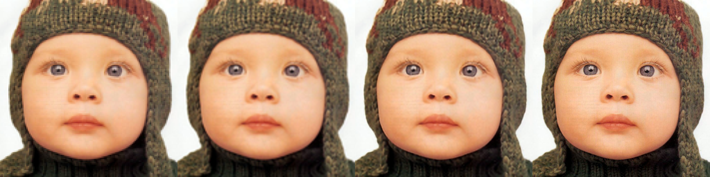
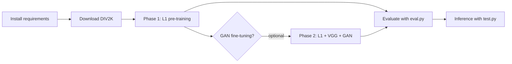

<h1 align="center">SRGAN ×4 Super-Resolution in PyTorch</h1> <p align="center">  <br> <em>Left to right: low-resolution input (enlarged), bicubic, <b>ours</b>, original high-resolution image.</em> </p> <p align="center">    </p>

A PyTorch implementation of an SRGAN-style network for **4× single-image super-resolution**, trained on the [DIV2K](https://data.vision.ee.ethz.ch/cvl/DIV2K/) dataset. The generator predicts a residual on top of a bicubic upsample of the input, and training follows the two-phase recipe from the SRGAN paper: pixel-loss pre-training, followed by optional adversarial and perceptual fine-tuning. Results are benchmarked against bicubic interpolation on Set5 and Set14 using Y-channel PSNR and SSIM.

This is a learning project: a lightweight model trained on a short schedule on a single Nvidia RTX 4060 GPU. It clearly improves on bicubic, but it is not intended to compete with state-of-the-art models (see [Discussion](#discussion)).

## Contents

- [Highlights](#highlights)
- [Results](#results)
- [Method](#method)
- [Project structure](#project-structure)
- [Getting started](#getting-started)
- [Usage](#usage)
- [Discussion](#discussion)
- [References](#references)
- [License](#license)

## Highlights

- SRGAN-style generator with residual blocks, sub-pixel (PixelShuffle) upsampling, and a **bicubic skip connection**, so the network only has to learn the missing detail.
- **Two-phase training**: L1 pre-training (Phase 1), then optional L1 + VGG perceptual + adversarial fine-tuning (Phase 2).
- **Fast data pipeline**: DIV2K images are decoded once and cached in RAM; random crops and augmentations are done on the cached arrays.
- **Correct evaluation protocol**: Y-channel PSNR/SSIM with a border crop, and a bicubic baseline computed the same way (`eval.py`).
- Per-epoch validation reports PSNR, bicubic PSNR, and the **gain over bicubic**, so a model that has not learned anything is immediately visible.

## Results

Metrics are computed with `eval.py`. The LR input is produced by bicubic downsampling (PIL) of the HR image, and PSNR/SSIM are measured after cropping a 4-pixel border, on 8-bit rounded outputs. The bicubic baseline is evaluated in exactly the same way.

### Quantitative: Set5 (×4)

| Image       | Bicubic PSNR / SSIM | Ours PSNR / SSIM  | Gain (dB) |
| ----------- | ------------------- | ----------------- | --------- |
| baby        | 31.78 / 0.868       | 33.35 / 0.898     | +1.57     |
| bird        | 30.18 / 0.881       | 32.38 / 0.920     | +2.20     |
| butterfly   | 22.10 / 0.752       | 24.07 / 0.831     | +1.97     |
| head        | 31.61 / 0.772       | 32.45 / 0.799     | +0.84     |
| woman       | 26.47 / 0.842       | 28.54 / 0.890     | +2.07     |
| **Average** | **28.43 / 0.823**   | **30.16 / 0.868** | **+1.73** |

| Dataset | Bicubic PSNR / SSIM | Ours PSNR / SSIM | Gain (dB) |
| ------- | ------------------- | ---------------- | --------- |
| Set5    | 28.43 / 0.823       | 30.16 / 0.868    | +1.73     |
| Set14   | 26.09 / 0.722       | 27.28 / 0.767    | +1.19     |

### Qualitative

<p align="center">  <br>  <br> <em>Left to right: low-resolution input (enlarged), bicubic, ours, original.</em> </p>

## Method

### Generator

```
LR image ──► 9×9 Conv + PReLU --> N × Residual block --> Conv + BN ──┐
                      │                                              │ (long skip)
                      └──────────────────────────────────────────────┘
                                         │
                      2 × [Conv -> PixelShuffle(2) -> PReLU]  (×4 total)
                                         │
                                    9×9 Conv --> (+) bicubic upsample of LR --> clamp[-1, 1] --> SR image
```

- Each residual block is `Conv3×3 → BN → PReLU → Conv3×3 → BN` with an identity skip.
- The output convolution produces a residual that is added to a bicubic ×4 upsample of the input, so the network starts from bicubic quality and learns the missing high-frequency detail.
- The number of residual blocks is configurable with `--num_res_blocks`.

### Discriminator

A 9×9 stem convolution followed by seven 3×3 convolutions (four of them with stride 2), each with BatchNorm and LeakyReLU(0.2), then global average pooling and two 1×1 convolutions that output a single logit. It is trained with `BCEWithLogitsLoss`.

### Training

|Phase|Flags|Generator loss|Discriminator|
|---|---|---|---|
|1. Pre-training|`--gan_weight 0.0 --vgg_weight 0.0`|L1|not used|
|2. Fine-tuning (optional)|`--gan_weight 1e-3 --vgg_weight 0.006`|L1 + 0.006 · VGG + 1e-3 · adversarial|BCE on real / fake|

- **Perceptual loss**: L1 distance between VGG19 feature maps (up to `relu5_4`) of the generated and ground-truth images.
- **Data**: 128×128 HR crops with the matching 32×32 LR crops from the official DIV2K ×4 images, random horizontal flips and 90° rotations, inputs normalised to [-1, 1].
- **Optimisation**: Adam (generator β = 0.9 / 0.999, discriminator β = 0.5 / 0.999), cosine learning-rate decay on the generator down to 1e-6.
- **Validation**: after every epoch on 256×256 center crops of the DIV2K validation set, logging Y-channel PSNR, bicubic PSNR, gain over bicubic, and SSIM.

Released weights were trained with:

| Setting               | Value                 |
| --------------------- | --------------------- |
| Residual blocks       | 8                     |
| Epochs                | 20                    |
| Batch size            | 128                   |
| Initial learning rate | 0.0002                |
| Hardware / time       | RTX 4060, ~50 minutes |

## Project structure

```
srgan-div2k/
├── model.py                 Generator and Discriminator
├── load.py                  Cached DIV2K training / validation datasets
├── loss.py                  VGG perceptual loss
├── train.py                 Training loop with per-epoch validation
├── eval.py                  Benchmark evaluation (Y-channel PSNR / SSIM vs. bicubic)
├── test.py                  Single-image inference
├── gen_val_lr_images.py     Generate ×4 LR validation images from DIV2K HR
├── weights/                 Pre-trained generator weights
├── Set5/                    Images used in this README
├── Set14/
├── eval_set5/
├── eval_set14/
├── requirements.txt
└── LICENSE
```

## Getting started

```bash
git clone https://github.com/YazanDash/srgan-div2k.git
cd srgan-div2k

python -m venv .venv
# Windows:      .venv\Scripts\activate
# macOS/Linux:  source .venv/bin/activate

pip install -r requirements.txt
```

PyTorch builds differ by CUDA version. For GPU training, install `torch` and `torchvision` from [pytorch.org](https://pytorch.org/get-started/locally/) first, then run the command above. The first training run also downloads the pretrained VGG19 weights (about 550 MB).

### Data

Download the DIV2K training and validation sets (HR images and ×4 bicubic LR images) from the [official DIV2K page](https://data.vision.ee.ethz.ch/cvl/DIV2K/) and extract them so the folders look like this:

```
<data_root>/
├── DIV2K_train_HR/DIV2K_train_HR/            *.png
├── DIV2K_train_LR_bicubic_X4/X4/             *.png
├── DIV2K_valid_HR/DIV2K_valid_HR/            *.png
└── DIV2K_valid_LR_bicubic_X4/X4/             *.png
```

If your download has no validation LR images, generate them from the HR validation images:

```bash
python gen_val_lr_images.py
```

Training loads all images into RAM once, which needs roughly 8 GB of free memory.

## Usage



### 1. Evaluate the pre-trained model

Put the **high-resolution** benchmark images (for example Set5) in a folder and run:

```bash
python eval.py --data_dir Set5 --checkpoint weights/netG_phase1.pth --num_res_blocks 8 --output_dir eval_set5
```

For every image, `eval.py` creates the LR input, runs bicubic and the model, and prints a table of Y-channel PSNR/SSIM. It saves `results.csv` plus `*_sr.png`, `*_bicubic.png`, and `*_compare.png` panels to the output folder.

### 2. Run on a single image

```bash
python test.py --image_name path/to/image.png --checkpoint weights/netG_phase1.pth --num_res_blocks 8
```

The image is downsampled 4× first and then reconstructed, so you can compare the result with the original. The SR output and the bicubic baseline are written to `out_srf_4/`.

### 3. Use the generator in your own code

```python
import torch
from model import Generator

G = Generator(scale_factor=4, num_res_blocks=8)
G.load_state_dict(torch.load("weights/netG_phase1.pth", map_location="cpu"))
G.eval()

# x: LR tensor of shape [1, 3, H, W] with values in [-1, 1]
with torch.no_grad():
    sr = G(x)   # [1, 3, 4H, 4W] in [-1, 1]
```

### 4. Train

**Phase 1** (L1 pre-training):

```bash
python train.py --data_root /path/to/data --gan_weight 0.0 --vgg_weight 0.0 \
    --num_res_blocks 8 --epochs 20 --batch_size 128 --lr 2e-4
```

**Phase 2** (optional GAN fine-tuning, starting from the Phase 1 generator). Copy your Phase 1 checkpoint somewhere safe first, because both phases write to `checkpoints/`:

```bash
python train.py --data_root /path/to/data --gan_weight 1e-3 --vgg_weight 0.006 \
    --num_res_blocks 8 --epochs 10 --batch_size 16 --lr 1e-5 \
    --load_checkpoint phase1/netG_phase1.pth
```

Each epoch prints validation PSNR, bicubic PSNR, gain, SSIM, and the current learning rate, and saves `checkpoints/netG_epoch_N.pth` and a sample image in `epochs/`.

|Argument|Default|Description|
|---|---|---|
|`--data_root`|`.`|Folder containing the extracted `DIV2K_*` folders|
|`--scale_factor`|4|Upscale factor (the provided data layout is for ×4)|
|`--train_crop_size`|128|HR training crop size|
|`--val_crop_size`|256|HR validation crop size|
|`--batch_size`|16|Batch size|
|`--epochs`|25|Number of epochs|
|`--lr`|1e-4|Initial learning rate|
|`--num_workers`|4|DataLoader workers|
|`--gan_weight`|1e-3|Adversarial loss weight (0 disables the discriminator)|
|`--vgg_weight`|0.006|Perceptual loss weight (0 disables VGG, which is much faster)|
|`--num_res_blocks`|8|Residual blocks in the generator|
|`--load_checkpoint`|none|Generator weights to start from|

### Troubleshooting

- **Size mismatch or missing keys when loading weights**: `--num_res_blocks` must match the value the checkpoint was trained with.
- **Out of GPU memory**: lower `--batch_size`, or use `--cpu` with `eval.py` for large images.
- **PSNR drops in Phase 2**: expected. Adversarial training favors sharp, plausible texture over pixel accuracy, so judge Phase 2 visually.

## Discussion

The model improves on bicubic on every Set5 image, by +1.73 dB PSNR on average. For context, published Set5 ×4 results are roughly 30.5 dB for SRCNN and 32.5 dB for EDSR, which were trained for far longer and (for EDSR) with much larger networks. The numbers are not directly comparable, because papers usually downsample with MATLAB's `imresize` while this repository uses PIL bicubic. Still, the result places this model in the range of early CNN-based methods, which is what a short training schedule on a lightweight network should give.

Limitations:

- Fine texture (hair, freckles, individual stitches) is smoothed rather than recovered.
- Short training schedule and a small network compared with published models.
- BatchNorm in the generator, which later work (EDSR) found to hurt SR quality.
- Only ×4 and a small benchmark suite (Set5, Set14) are evaluated.

Possible next steps: longer training, a BatchNorm-free generator, more residual blocks, ablations (bicubic skip, depth, loss terms), perceptual metrics such as LPIPS for the GAN model, and evaluation on larger benchmarks.

## References

1. C. Ledig et al., _Photo-Realistic Single Image Super-Resolution Using a Generative Adversarial Network_ (SRGAN), CVPR 2017. [arXiv:1609.04802](https://arxiv.org/abs/1609.04802)
2. B. Lim et al., _Enhanced Deep Residual Networks for Single Image Super-Resolution_ (EDSR), CVPR Workshops 2017. [arXiv:1707.02921](https://arxiv.org/abs/1707.02921)
3. X. Wang et al., _ESRGAN: Enhanced Super-Resolution Generative Adversarial Networks_, ECCV Workshops 2018. [arXiv:1809.00219](https://arxiv.org/abs/1809.00219)
4. J. Johnson et al., _Perceptual Losses for Real-Time Style Transfer and Super-Resolution_, ECCV 2016. [arXiv:1603.08155](https://arxiv.org/abs/1603.08155)
5. E. Agustsson and R. Timofte, _NTIRE 2017 Challenge on Single Image Super-Resolution: Dataset and Study_ (DIV2K), CVPR Workshops 2017. [Dataset page](https://data.vision.ee.ethz.ch/cvl/DIV2K/)
6. M. Bevilacqua et al., _Low-Complexity Single-Image Super-Resolution Based on Nonnegative Neighbor Embedding_ (Set5), BMVC 2012.
7. R. Zeyde et al., _On Single Image Scale-Up Using Sparse-Representations_ (Set14), Curves and Surfaces 2010.

## License

Released under the license in the LICENSE file.

Author: [YazanDash](https://github.com/YazanDash)
